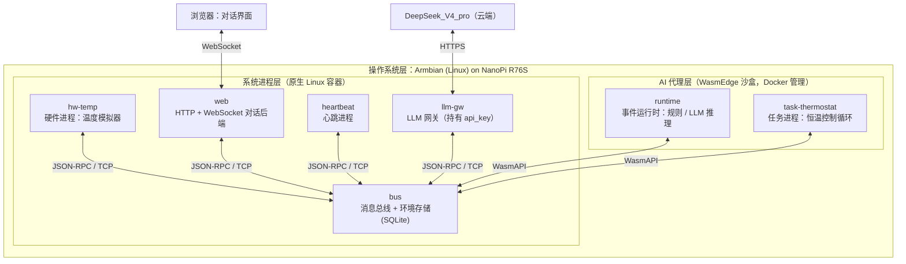
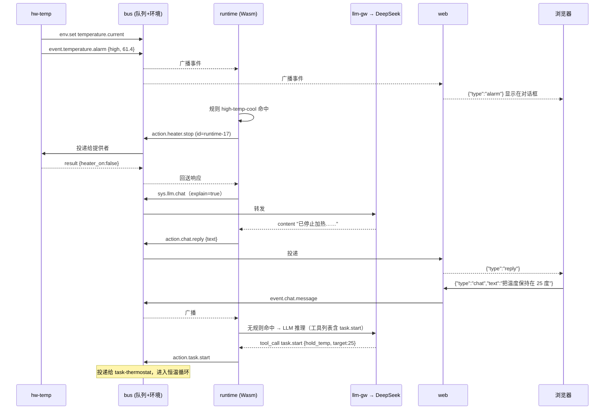

# 事件驱动型智能体 · 软件设计文档（NanoPi R76S 演示系统）

> 版本 0.1 · 2026-10-20 · 依据《事件驱动型智能体》整理 本文档的读者是 **Claude Code** 等 AI 编程工具。文中凡标注 **【固定】** 的内容来自原始需求，不得更改；标注 **【提案】** 的内容是为了让需求可执行而补充的设计决策，可在实现中按需调整，但调整后必须同步更新本文档。

## 1. 目标与范围

本项目要在 NanoPi R76S 上实现一个**事件驱动的 Agent 架构**演示系统。与传统事件驱动架构（例如 IEC 61499 功能块网络，事件到操作的映射由有限状态机完全确定）不同，本系统中“事件 → 操作”的选择可以由规则决定，也可以由 LLM 推理决定；事件-操作状态机的职责交给 LLM，开发者只需把功能块里的算法写成普通的进程。**【固定】**

本文档覆盖的交付物是原文“试验系统”一节定义的**最小系统**：

- 一个硬件进程，模拟温度传感器：定时更新温度，范围 -10 ℃ 到 +80 ℃；温度低于 0 ℃ 或高于 60 ℃ 时产生告警事件；提供“启动加热 / 停止加热 / 读取温度值”三个操作。**【固定】**

- 系统进程包含一个简单的 Web Server 和 WebSocket 后端，前端是典型的大语言模型对话界面，告警信息在对话框中显示。**【固定】**

- AI 代理层（运行时、任务进程、环境）在 Wasm 沙盒中运行，Wasm 运行时采用 WasmEdge，由 Docker 管理，Docker 底层容器替换为 WasmEdge 运行时。**【固定】**

- 云端大模型 DeepSeek_V4_pro,`api_url` 与 `api_key` 在 `config.json` 中定义。**【固定】**

- 消息格式符合 JSON-RPC 2.0，每个进程有自己的消息队列，消息分为“事件”和“操作”两类。**【固定】**

不在本次范围内：真实的 Modbus / IO 总线、机械臂控制、Zephyr OS、RAG 规则检索。架构上为它们预留了扩展点（见 §12）。

## 2. 目标平台

### 2.1 硬件：NanoPi R76S

| 项目 | 规格 | 对设计的影响 |
| --- | --- | --- |
| SoC | Rockchip RK3576，4× Cortex-A72 @ 2.2 GHz + 4× Cortex-A53 @ 1.8 GHz,Mali-G52 MC3 GPU,6 TOPS NPU | 64 位 ARM（aarch64），所有宿主二进制按 `aarch64-unknown-linux-gnu` 构建；NPU 本期不用 |
| 内存 | 2 GB / 4 GB LPDDR4X 或 16 GB LPDDR5（按采购型号） | 2 GB 型号不建议在板上编译 Rust，改用交叉编译（§10） |
| 存储 | 32 GB eMMC（部分型号 64 GB）,microSD 卡槽 | 系统、Docker 镜像、SQLite 数据都放 eMMC；镜像总量控制在 1 GB 以内 |
| 网络 | 2× 2.5 GbE（独立的 r8125 网卡，非交换芯片） | 一个口接上行网络访问云端 LLM，另一个口可接调试机 |
| 外设 | USB 3.2 Gen1 Type-A,M.2 E-Key（SDIO Wi-Fi 模块）,HDMI 2.0,FPC 扩展口（UART / I2C / GPIO） | 本期硬件进程是模拟器，不占用任何物理接口；后续真实传感器可走 FPC 或 USB 转串口 |
| 供电 | USB-C 5V | 无需关注 |

### 2.2 操作系统：Armbian **【固定】**

- 发行版：Armbian（Debian 基础，`rk35xx` 板级家族，内核目标 `vendor` / `edge`）。

- 原文系统分层中列出了 Linux `PREEMPT_RT`。Armbian 为 R76S 提供的默认内核**不是** RT 内核；最小系统（1 Hz 的模拟温度、秒级的 LLM 响应）不需要硬实时，因此本期不打 RT 补丁。真实 IO 场景下再评估。**【提案】**

- 运行所需的宿主软件：Docker Engine（arm64）、containerd、WasmEdge 共享库、`containerd-shim-wasmedge-v1`（runwasi）。安装步骤见 §10.3。

## 3. 技术栈

> **选型原则 【提案】**：全部代码使用 **Rust** 一种语言。理由是 \(1\) AI 代理层必须编译成 Wasm 并在 WasmEdge 中运行，Rust 是 WasmEdge 支持最成熟的来宾语言；\(2\) 宿主进程与 Wasm 进程共享同一套协议 crate，避免两种语言各写一份消息定义；\(3\) 目标是 2–4 GB 内存的 SBC，Rust 产物无运行时、内存占用小。前端只用无构建步骤的原生 HTML/JS，减少工具链。

| 层 | 组件 | 选型 | 说明 |
| --- | --- | --- | --- |
| 语言 | 宿主进程 / Wasm 进程 | Rust stable ≥ 1.78（含 `wasm32-wasip1` 目标） | 单一工具链；`edition = "2021"` |
| 宿主异步运行时 | 系统进程 | `tokio` | 多路复用 TCP、定时器、子任务 |
| Web | Web Server + WebSocket | `axum`（含 `ws` 特性）+ `tower-http` | 静态页面用 `include_str!` 内嵌到二进制，无需外部文件 |
| 序列化 | 全部消息 | `serde` + `serde_json` | JSON-RPC 2.0 结构体定义在共享 crate `ea-proto` |
| 持久化 | 环境 / 历史数据 | `rusqlite`（`bundled` 特性）→ SQLite 单文件 | 原文允许大数据量时用数据库；SQLite 在 eMMC 上足够，且无需额外服务 |
| LLM 访问 | LLM 网关 | `reqwest`（`rustls-tls`） | DeepSeek 提供 OpenAI 兼容的 `chat/completions` 接口，用 function calling 返回结构化操作 |
| Wasm 来宾网络 | WasmAPI | `wasmedge_wasi_socket`（同步 TCP） | Wasm 进程只开一条到消息总线的 TCP 连接，所有系统访问都经由该连接；不在 Wasm 内做 TLS |
| Wasm 运行时 | AI 代理层沙盒 | **WasmEdge** **【固定】** | 来宾目标 `wasm32-wasip1`；可选 `wasmedge compile` 做 AOT 以缩短启动时间 |
| 容器编排 | 全部进程 | **Docker** + containerd image store + runwasi `io.containerd.wasmedge.v1` **【固定】** | 宿主进程是普通 Linux 容器；Wasm 进程以 `platform: wasi/wasm` 运行在 WasmEdge shim 上 |
| 前端 | 对话界面 | 原生 HTML + CSS + JavaScript（单文件） | 不引入 npm / 打包器 |
| 日志 | 全部进程 | `tracing` + `tracing-subscriber`，输出到 stdout | 由 `docker compose logs` 统一收集 |
| 配置 | 全系统 | `config.json`（**【固定】** 文件名）+ `rules.json` | 见 §9 |
| 构建 | 交叉编译 | `cross`（或板上原生 `cargo`）+ `docker buildx` | 见 §10 |

## 4. 系统架构

### 4.1 分层 **【固定】**



### 4.2 关键设计决策

> **D1 消息队列的实现位置 【提案】**。原文要求“每个进程都有一个消息队列”。实现上由 `bus` 进程为每个已注册的进程维护一个有界的入站队列（inbox），进程通过一条 TCP 长连接收发。不引入 NATS / Redis / ZeroMQ 等外部中间件：一是 Wasm 来宾侧要保持最小依赖，二是总线逻辑只有几百行，自己实现比适配第三方客户端到 WasmEdge 更可控。

> **D2 LLM 调用不在沙盒内发起 【提案】**。`api_key` 只被原生进程 `llm-gw` 读取；Wasm 中的运行时通过总线发送 `sys.llm.chat` 请求，由网关代为调用云端。这样沙盒内的代码（AI 生成、可信度较低）拿不到密钥，也不需要在 WasmEdge 内处理 TLS。

> **D3 环境（Environment）作为总线提供的服务 【提案】**。原文把环境定义为“系统的全局变量：状态、公共变量、历史数据”，并归入 AI 代理层。由于运行时与多个任务进程各自运行在独立的 Wasm 沙盒中，内存不能共享，因此环境的**存储**放在 `bus` 进程（内存 KV + SQLite 持久化），AI 代理层通过 `env.*` 方法读写。逻辑上它仍属于 AI 代理层的数据，物理上由总线托管。

> **D4 任务进程的创建方式 【提案】**。原文要求“异步处理事件将新建一个任务进程”。沙盒内的运行时无法直接调用 Docker 创建容器。本期做法：任务进程作为常驻的 Wasm 容器由 compose 启动，空闲时等待 `action.task.start`，收到后在进程内启动一个任务实例；运行时“新建任务”即发送该操作。按需动态 `docker run` 作为二期的 `spawner` 服务预留（§12）。

### 4.3 进程清单

| 进程名（总线注册名） | 层 | 运行形态 | 订阅（事件） | 提供（操作 / 服务） |
| --- | --- | --- | --- | --- |
| `bus` | 系统进程 | 原生容器，监听 `127.0.0.1:7700` | — | `sys.*`、`env.*` |
| `hw-temp` | 系统进程（硬件进程） | 原生容器 | — | `action.heater.start`、`action.heater.stop`、`action.temperature.read`、`action.temperature.set_ambient` |
| `web` | 系统进程（对话后端） | 原生容器，监听 `0.0.0.0:8080` | `event.temperature.*`、`event.process.*`、`event.task.*` | `action.chat.reply` |
| `heartbeat` | 系统进程 | 原生容器 | — | 发布 `event.heartbeat.tick`、`event.process.down/up` |
| `llm-gw` | 系统进程 | 原生容器 | — | `sys.llm.chat` |
| `runtime` | AI 代理层 | Wasm（WasmEdge） | `event.*` | `action.runtime.*`（预留） |
| `task-thermostat` | AI 代理层（任务进程） | Wasm（WasmEdge） | `event.task.stop` | `action.task.start`、`action.task.stop` |
| `motor-ecat` | 系统进程（**实时**硬件进程） | **原生进程**（非容器，见 §8.8） | — | `action.motor.*` |
| `task-motor` | AI 代理层（任务进程） | Wasm（WasmEdge） | — | `action.task.motor_demo` |

所有进程都必须响应 `sys.ping` 请求。

## 5. 消息协议

### 5.1 传输

- 传输：TCP，地址 `127.0.0.1:7700`（所有容器使用 `network_mode: host`，因此 Wasm 进程也能直接连接）。**【提案】**

- 帧格式：NDJSON，每条消息是一行 UTF-8 JSON，以 `\n` 结尾；单行上限 1 MiB，超限断开连接。

- 连接建立后第一条消息必须是 `sys.register` 请求，否则总线在 5 s 后关闭连接。

- 连接断开即视为进程下线，其订阅与提供关系被清除；进程重连后重新注册。客户端库负责自动重连（指数退避，上限 10 s）。

### 5.2 消息类型与 JSON-RPC 2.0 的对应 **【固定：格式符合 JSON-RPC 2.0】**

| 原文概念 | JSON-RPC 2.0 形式 | 路由规则 |
| --- | --- | --- |
| 事件（Event） | Notification（无 `id`） | 总线按 `method` 前缀匹配，**广播**给所有订阅者 |
| 操作（Action） | Request（有 `id`） | 总线按 `method` 前缀匹配，投递给**唯一**的提供者；无提供者则返回错误 `-32601` |
| 操作结果 | Response（`result` 或 `error`） | 总线按 `id` 回送给请求发起者 |

`params` 统一使用信封结构：

```json
{"source": "<发送进程名>", "ts": "<RFC 3339 UTC 时间戳>", "data": { }}
```

`source` 由总线在转发时覆写为实际的发送者，客户端填写的值不被信任。`id` 由客户端库生成，格式 `<进程名>-<单调递增整数>`。

### 5.3 方法命名

格式 `<类别>.<域>.<名称>`，全部小写，类别只允许四种：

- `event.`：事件，例如 `event.temperature.alarm`

- `action.`：操作，例如 `action.heater.start`

- `sys.`：总线与系统服务，例如 `sys.register`、`sys.llm.chat`

- `env.`：环境读写，例如 `env.set`

订阅与提供都用前缀匹配：`event.temperature.*` 匹配 `event.temperature.updated` 与 `event.temperature.alarm`；`event.*` 匹配全部事件。

### 5.4 示例

事件（硬件进程发出高温告警）：

```json
{"jsonrpc":"2.0","method":"event.temperature.alarm","params":{"source":"hw-temp","ts":"2026-10-20T10:00:00Z","data":{"level":"high","value":61.4,"threshold":60.0}}}
```

操作（运行时请求停止加热）与响应：

```json
{"jsonrpc":"2.0","id":"runtime-17","method":"action.heater.stop","params":{"source":"runtime","ts":"2026-10-20T10:00:01Z","data":{}}}
{"jsonrpc":"2.0","id":"runtime-17","result":{"heater_on":false}}
```

错误响应（无提供者）：

```json
{"jsonrpc":"2.0","id":"runtime-18","error":{"code":-32601,"message":"no provider for action.robot.pick"}}
```

### 5.5 总线系统方法（`sys.*`、`env.*`）

| 方法 | 类型 | `data` 参数 | 返回 | 说明 |
| --- | --- | --- | --- | --- |
| `sys.register` | Request | `name: string`，`subscribe: string[]`，`provide: string[]`，`actions: ActionSpec[]` | `{"ok":true}` | 注册进程；`name` 重复则错误 `-32000`。`actions` 是该进程提供的操作说明，供 LLM 构造工具列表 |
| `sys.ping` | Request | `{"target": string?}` | `{"pong":true,"uptime_s":number}` | 由心跳进程发起，每个进程必须实现；`target` 为空/省略时由总线自身应答，否则总线把请求转发给该进程 |
| `sys.registry.list` | Request | `{}` | `{"processes":[{name, subscribe, provide, connected_at}]}` | 心跳与运行时使用 |
| `sys.registry.actions` | Request | `{}` | `{"actions": ActionSpec[]}` | 汇总所有进程注册的操作说明 |
| `sys.llm.chat` | Request | 见 §8.5 | 见 §8.5 | 由 `llm-gw` 提供，总线只做转发 |
| `env.get` | Request | `key: string` | `{"value": any \| null}` | — |
| `env.set` | Request | `key: string`，`value: any`，`history: bool`（默认 `false`） | `{"ok":true}` | 写入后总线广播 `event.env.changed {key, value}`；`history=true` 时同时追加一条历史记录 |
| `env.snapshot` | Request | `prefix: string`（默认 `""`） | `{"values": {key: value}}` | 供 LLM 推理时作为上下文 |
| `env.history` | Request | `key: string`，`limit: number`（默认 100，上限 1000） | `{"items":[{ts, value}]}` | 按时间倒序 |

`ActionSpec` 结构：

```json
{"method":"action.heater.start","description":"启动加热器","params_schema":{"type":"object","properties":{}}}
```

## 6. 环境（Environment）数据模型

环境是系统的全局变量 **【固定】**。最小系统使用的键如下 **【提案】**：

| 键 | 类型 | 写入者 | 含义 |
| --- | --- | --- | --- |
| `temperature.current` | number（℃） | `hw-temp` | 当前温度，每个采样周期写一次，`history=true` |
| `temperature.state` | `"normal" \| "low" \| "high"` | `hw-temp` | 告警状态 |
| `heater.on` | bool | `hw-temp` | 加热器状态 |
| `alarm.active` | bool | `hw-temp` | 是否存在未清除的告警 |
| `task.hold_temp.enabled` | bool | `runtime` / `task-thermostat` | 恒温任务是否运行 |
| `task.hold_temp.target` | number（℃） | `runtime` | 恒温目标 |
| `chat.last_user_message` | string | `runtime` | 最近一条用户消息，供推理参考 |

SQLite 表结构（文件 `/data/env.db`）：

```sql
CREATE TABLE env_kv   (key TEXT PRIMARY KEY, value TEXT NOT NULL, updated_at TEXT NOT NULL);
CREATE TABLE env_hist (id INTEGER PRIMARY KEY, ts TEXT NOT NULL, key TEXT NOT NULL, value TEXT NOT NULL);
CREATE TABLE event_log(id INTEGER PRIMARY KEY, ts TEXT NOT NULL, method TEXT NOT NULL, params TEXT NOT NULL);
CREATE INDEX env_hist_key_ts ON env_hist(key, ts);
```

总线把所有经手的 `event.*` 追加到 `event_log`（`event.temperature.updated` 除外，避免 1 Hz 写入撑大数据库；温度历史已经在 `env_hist` 中）。

## 7. Agent API **【固定：分为 WasmAPI 与系统 API 两部分】**

两套 API 使用完全相同的协议（§5），只是运行目标不同。它们共享 `ea-proto` crate 中的消息类型，接口形状保持一致，便于把同一段业务逻辑在原生和 Wasm 之间迁移。

### WasmAPI（crate `ea-wasmapi`）

- 目标：`wasm32-wasip1`，运行于 WasmEdge.

- 网络：`wasmedge_wasi_socket::TcpStream`，**同步阻塞**，单线程事件循环。

- 核心类型：`Client`

  - `Client::connect(addr) -> Result<Client>`

  - `register(name, subscribe, provide, actions)`

  - `next() -> Result<Incoming>`：阻塞读取下一条入站消息（事件或请求）

  - `call(method, data, timeout) -> Result<Value>`：发送操作并等待响应；等待期间收到的事件缓存到内部队列，`next()` 后续返回

  - `emit(method, data)`：发送事件

  - `reply(id, result)` / `reply_error(id, code, msg)`

  - `env_get / env_set / env_snapshot / env_history`

  - `llm_chat(req) -> LlmResponse`：对 `sys.llm.chat` 的封装

- 不做：线程、TLS、文件系统（除读取挂载的配置目录）。

### 系统 API（crate `ea-sysapi`）

- 目标：`aarch64-unknown-linux-gnu`（原生）。

- 网络：`tokio::net::TcpStream`，异步。

- 核心类型：`Client`，方法与 WasmAPI 同名，全部为 `async fn`。

- 额外提供：

  - `serve(handler)`：以回调方式处理入站请求，每个请求在独立 tokio task 中处理

  - 自动重连与重新注册

  - `tracing` 集成，记录每条收发消息（`debug` 级）

- `bus` 自身不使用此 crate（它是服务端）。

## 8. 进程设计

### 8.1 `bus`：消息总线 + 环境存储

- 监听 `127.0.0.1:7700`，每个连接一个 tokio task 读、一个 task 写；每个已注册进程一个有界 `mpsc` 队列（容量 1024）作为它的消息队列。队列满时丢弃最旧的 **事件**，但 **操作与响应** 不丢弃（反压到发送方）。

- 路由表：`subscriptions: Vec<(prefix, process)>`，`providers: HashMap<prefix, process>`。注册时若 `provide` 前缀与已有提供者冲突，返回错误 `-32001`。

- 待响应表：`pending: HashMap<id, (requester, deadline)>`；提供者在 30 s 内未响应则向请求者返回 `-32002 timeout`。

- 环境存储：内存 `HashMap<String, Value>` 为主，启动时从 SQLite 加载；写入同步落盘（SQLite WAL 模式）。

- 启动参数：`--listen 127.0.0.1:7700 --db /data/env.db`。

### 8.2 `hw-temp`：硬件进程（温度模拟器） **【固定的行为要求见 §1】**

模拟模型 **【提案】**，每 1 s 一个采样周期：

$$T_{k+1} = \operatorname{clamp}\big(T_k + h_k \cdot P - \alpha\,\max(T_k - T_{amb},\,0),\; -10,\; 80\big)$$

其中 $$\alpha = 0.3$$（时间常数 ≈ 3.3 s，保证 §12「10 s 内 low 告警」可达成），加热功率 $$P = 25\ ℃/s$$（**唯一热源**，为快速触达 high 告警而校准），$$h_k \in \{0,1\}$$ 为加热器状态；环境温度 $$T_{amb}$$ 只作**冷源**——室温高于环境时按 $$\alpha(T_k - T_{amb})$$ 散热，环境高于室温时**不被动加热**房间。因此温度上升只能来自加热器开、下降来自加热器关/环境散热。$$T_{amb}$$ 默认按 20 分钟周期在 -8 ℃ 到 20 ℃ 之间正弦摆动（冷相自然触发 low 告警）；可通过 `action.temperature.set_ambient {value, hold: bool}` 固定它。初始 $$T_0 = 25$$。

告警判定（带回差，避免抖动）**【提案：回差 2 ℃】**：

| 当前状态 | 条件 | 新状态 | 发出事件 |
| --- | --- | --- | --- |
| `normal` | `T < 0` | `low` | `event.temperature.alarm {level:"low", value, threshold:0}` |
| `normal` | `T > 60` | `high` | `event.temperature.alarm {level:"high", value, threshold:60}` |
| `low` | `T ≥ 2` | `normal` | `event.temperature.alarm_cleared {level:"low", value}` |
| `high` | `T ≤ 58` | `normal` | `event.temperature.alarm_cleared {level:"high", value}` |

告警事件只在状态**切换**时发出一次；每个采样周期另外发 `event.temperature.updated {value, heater_on, state}` 并写 `env.set temperature.current`（`history=true`）。

提供的操作：

| 方法 | `data` | 返回 |
| --- | --- | --- |
| `action.heater.start` | `{}` | `{"heater_on":true}` |
| `action.heater.stop` | `{}` | `{"heater_on":false}` |
| `action.temperature.read` | `{}` | `{"value":number,"state":string,"heater_on":bool,"ts":string}` |
| `action.temperature.set_ambient` | `{"value":number,"hold":bool}` | `{"ambient":number,"hold":bool}` |

后续接真实传感器时，只替换本进程内部的“采样”与“执行”两个函数，对外接口不变。

### 8.3 `web`：对话后端 **【固定：简单 Web Server + WebSocket；前端为浅色三栏布局，告警在仪表盘与对话框同时显示】**

- `GET /`：返回内嵌的单页 `index.html`。

- `GET /ws`:WebSocket。浏览器 ↔ `web` 的消息是简单 JSON（不是 JSON-RPC，这是系统边界之外的接口）：

  - 浏览器 → 服务：`{"type":"chat","text":"..."}`、`{"type":"control","cmd":"heater.on|heater.off|ambient.set|ambient.resume|temperature.read","value":..}`（控制命令由 `web` 映射到总线 action）

  - 服务 → 浏览器：`{"type":"reply","text":"..."}`、`{"type":"alarm","level":"high","value":61.4,"text":"..."}`、`{"type":"alarm_cleared",...}`、`{"type":"temperature","value":..,"heater_on":..,"state":..}`、`{"type":"status","processes":[...]}`、`{"type":"control_result","cmd":..,"ok":..,"result":..}`

- `web` 把浏览器的聊天消息转为事件 `event.chat.message {session, text}` 发到总线；它提供 `action.chat.reply {session, text}`，收到后推送给对应 WebSocket；`session` 为空字符串时广播给所有连接。

- 订阅 `event.temperature.alarm*`、`event.process.*`、`event.task.*` 并原样推送给浏览器——因此即使运行时或 LLM 不可用，告警也能在对话框中显示。`event.temperature.updated` 以 1 Hz 推送用于页面右上角的温度显示。

- 前端（单文件 `index.html`，浅色三栏）：左栏「控制面板」为控制参数属性选择树（加热器开关、环境温度固定/恢复正弦、读取当前温度），交互经 `{"type":"control"}` 发到 `web`；中栏「仪表盘」显示当前温度、加热器/告警/在线进程状态与最近事件；右栏「AI 对话」为对话框。告警消息以红色样式同时显示在仪表盘横幅与对话流中。界面文字为中文。

### 8.4 `heartbeat`：心跳进程

- 每 2 s：调用 `sys.registry.list`，对每个进程发 `sys.ping`（超时 1 s）。掉线判定：进程从注册表消失 → 立即发 `event.process.down {name}`；仍在册但连续 3 次 ping 失败（软挂）→ 发 `event.process.down`；重新出现 / ping 恢复 → 发 `event.process.up`。

- 每 5 s 发 `event.heartbeat.tick {ts, alive: string[]}`。

- 它是运行时感知系统健康的唯一来源；运行时可以把“进程掉线”交给 LLM 解释并在对话框里提示用户。

### 8.5 `llm-gw`：LLM 网关 **【固定：云端 DeepSeek_V4_pro;api_url / api_key 在 config.json】**

提供 `sys.llm.chat`：

```json
// 请求 data
{"messages":[{"role":"system","content":"..."},{"role":"user","content":"..."}],
 "tools":[{"type":"function","function":{"name":"action.heater.start","description":"...","parameters":{...}}}],
 "temperature":0.2,"max_tokens":1024}
// 返回 result
{"content":"...","tool_calls":[{"name":"action.heater.start","arguments":{}}],"usage":{"prompt_tokens":0,"completion_tokens":0}}
```

- 调用 `POST {api_url}/chat/completions`，OpenAI 兼容格式，`Authorization: Bearer {api_key}`，模型名取 `config.json` 的 `llm.model`。

- 超时 60 s；HTTP 429 / 5xx 重试 2 次（间隔 2 s、4 s）。失败返回 JSON-RPC 错误 `-32010 llm_unavailable`，并附上游状态码。

- 只记录 token 用量，不记录消息正文到日志（避免把对话内容写进 stdout）。

### 8.6 `runtime`：事件运行时（Wasm） **【固定：收到事件后，按事件类型调用基于规则的处理程序或调用 LLM；异步处理交给任务进程】**

主循环（单线程同步）：

```plaintext
connect → register(subscribe=["event.*"]) → loop { msg = next(); dispatch(msg) }
```

`dispatch` 的决策顺序：

1. 过滤：`event.temperature.updated`、`event.heartbeat.tick`、`event.env.changed` 默认不进入决策（只更新本地缓存），避免 1 Hz 事件反复触发推理。可在 `rules.json` 的 `ignore` 列表中调整。

2. 规则匹配：按 `rules.json` 顺序匹配第一条命中的规则，执行其 `then` 中的操作（通过 `call`，依次串行）。若规则含 `"explain": true`，再把事件、规则与操作结果交给 LLM 生成一句面向用户的说明，经 `action.chat.reply` 显示。

3. 无规则命中：进入 LLM 推理（下一节）。

4. 每次决策（无论规则或 LLM）向总线发 `event.runtime.decision {event_method, mode:"rule"|"llm", actions:[...]}`，作为可观测性记录。

LLM 推理回合：

- 上下文 = 系统提示（角色说明 + 可用操作清单，来自 `sys.registry.actions`）+ `env.snapshot` + 最近 20 条事件（本地环形缓冲）+ 触发事件本身 + 若为聊天事件则包含用户文本。

- 工具 = 全部 `action.*` 的 `ActionSpec`，另加一个虚拟工具 `task.start {task, params}` 映射为 `action.task.start`。

- 循环：调用 `llm_chat` → 若返回 `tool_calls`，逐个执行并把结果以 `tool` 角色追加 → 再次调用；最多 5 轮。最终的 `content` 经 `action.chat.reply` 送到对话框。

- 安全约束：运行时只能执行 `sys.registry.actions` 中登记过的方法；LLM 返回未登记的方法名时拒绝并记录。

本期 `rules.json` 的默认规则 **【提案】**：

```json
{
  "ignore": ["event.temperature.updated", "event.heartbeat.tick", "event.env.changed"],
  "rules": [
    {"id":"low-temp-heat",  "when":{"method":"event.temperature.alarm","data.level":"low"},
     "then":[{"method":"action.heater.start"}], "explain":true},
    {"id":"high-temp-cool", "when":{"method":"event.temperature.alarm","data.level":"high"},
     "then":[{"method":"action.heater.stop"}], "explain":true},
    {"id":"cleared",        "when":{"method":"event.temperature.alarm_cleared"},
     "then":[], "explain":true}
  ]
}
```

`event.chat.message` 与 `event.process.down` 没有规则，因此总是走 LLM。把 `rules` 清空即可演示“完全由 LLM 推理决定”的模式，两种模式对照正是原文的核心论点。

### 8.7 `task-thermostat`：任务进程（Wasm） **【固定：复杂异步循环操作由任务进程完成，任务进程是一个大功能块】**

- 提供 `action.task.start {task:"hold_temp", target:number, hysteresis:number=1.0}` 与 `action.task.stop {task}`。

- 收到 start 后进入控制循环：每 1 s `action.temperature.read`，`T < target - hysteresis` 则 `action.heater.start`，`T > target + hysteresis` 则 `action.heater.stop`；循环期间继续用 `next()` 轮询入站消息（`call` 带 1 s 超时实现非阻塞节拍），收到 stop 或 `env task.hold_temp.enabled=false` 则退出。

- 启动 / 停止时发 `event.task.started {task}` / `event.task.stopped {task, reason}`。

- 这是原文“循环读取总线数据、按算法控制温度”的最小版本；把 bang-bang 换成 PID 只改一个函数。

### 8.8 `motor-ecat`：实时运动控制进程（M5） **【提案】**

把 EtherCAT 步进电机（2 × MOONS STF06-ECX-mini，PP 模式）作为**实时硬件进程**接入统一 RPC 总线。

**线程模型（本进程的核心约束）**：

```text
bus ──JSON-RPC/TCP──> RPC 线程（tokio，普通优先级）
                       · 收 action.motor.*，投递命令后立即应答
                       · 按 10 Hz 读快照发 event.motor.status / reached / alarm
                             │  命令环（无锁 SPSC，AtomicU64 槽，定长）
                             │  状态快照（原子字段，无锁）
                       RT 线程（SCHED_FIFO 80 + 绑 CPU + 定向 mlock）
                       · 4 ms 周期 PDO 循环，只碰 IOmap
                       · 不做分配 / 加锁 / 日志 / 总线 I/O
```

- **RT 线程绝不等待 RPC**。命令是投递式的：`action.motor.move_abs` 立即返回 `{"accepted":true}`，运动完成由 `event.motor.reached` 通知。
- RT 线程每个周期最多排空 16 条命令，防止命令洪泛饿死 PDO 循环；环满时 RPC 返回 `INTERNAL_ERROR`。
- 周期调度用 `CLOCK_MONOTONIC` + `clock_nanosleep(TIMER_ABSTIME)`，不累积漂移。
- **定向 `mlock`（IOmap + 共享状态），严禁 `mlockall`**——锁住整个进程会破坏 AF_PACKET raw socket（周期 wkc 塌到 1、TxPDO 全零、伺服 Err 80）。
- `action.motor.stop` 走**急停独立路径**：直接置位 `estop`，RT 在下一个周期最优先处理，不排队等前面的命令。
- 允许 `EA_RT=0` 关闭实时调度（无 root 或排查抖动时降级为普通调度）。

**提供的操作**（全部投递即返回）：

| 方法 | `data` | 返回 |
| --- | --- | --- |
| `action.motor.enable` | `{axis?}`（省略=全部轴） | `{"accepted":true}` |
| `action.motor.stop` | `{axis?}` | `{"accepted":true,"estop":true}` |
| `action.motor.move_abs` | `{axis, position}` | `{"accepted":true}` |
| `action.motor.move_rel` | `{axis, delta}` | `{"accepted":true}` |
| `action.motor.home` | `{axis?}` | `{"accepted":true}` |
| `action.motor.set_velocity` | `{axis, velocity}`（counts/s，20000=1 圈/s） | `{"accepted":true}` |
| `action.motor.read` | `{}` | `{"axes":[{axis,position,velocity,statusword,error,enabled}],"wkc":3,"cycles":N}` |

`home` 是**软件置零**：MOONS 开环无原点传感器，不做机械回零；每次上电需人工把滑块放回起始端。

**发出的事件**：

| 事件 | 频率 | 是否进决策 |
| --- | --- | --- |
| `event.motor.status` | 10 Hz | **否**（在 `ignore` 列表，否则每秒 10 次 LLM 调用） |
| `event.motor.reached` | 到位沿（false→true） | **否** |
| `event.motor.alarm` | 伺服错误 / wkc 异常的上升沿 | **是** |

**运行形态**：**原生进程**（非 Docker 容器）——硬实时需要 `SCHED_FIFO`、绑核、raw socket 与定向 `mlock`，容器化会引入 cgroup 调度配额与 `RT_GROUP_SCHED` EPERM 等额外变量。这偏离 §4.3「所有进程容器化」的一般约定，属本节的显式例外。

**后端**（`Backend` trait，运行时用 `--mock` / `--ifname` 选择）：

| 后端 | 平台 | 用途 |
| --- | --- | --- |
| `MockBackend` | 全平台 | 软件仿真，验证线程模型与协议契约（`crates/bus/tests/m5.rs` 用它） |
| `SoemBackend` | **仅 Linux** | 真实 EtherCAT，经 `csrc/ea_ecat.c` 调 SOEM |

`SoemBackend` 的结构：

- **SOEM 2.0.0 已 vendor 进仓**（`crates/motor-ecat/vendor/soem/`，444 KB，只含 `include/` + `src/` + `osal/linux` + `oshw/linux`），由 `build.rs` 用 `cc`（build-dependency）编译；**不是运行时依赖**，macOS 目标上 `build.rs` 直接返回，符号不参与链接。⚠️ SOEM 是 **GPLv3 / 商业双许可**，按 GPLv3 使用（分发本进程即受 GPLv3 约束）。
- `csrc/ea_ecat.c` 只做「init → config_init → config_map_group → SAFE_OP → OP」+ 一次 PDO 收发 + 暴露从站 PDO 指针，**不含 PDO pump 线程**——周期由 Rust 的 RT 线程驱动，保证与总线 I/O 彻底分离。
- PDO 字节打包/解包留在 Rust（布局按 CLAUDE.md 的 MOONS 记录：RxPDO 13 B / TxPDO 35 B）。
- **`--probe --ifname <dev>`** 是接硬件的第一站：只读探测从站数量、vendor/product、PDO 尺寸与 AL 状态，**不使能伺服**。先确认布局再上电，避免用错偏移量驱动电机。
- 交叉编译（Mac → aarch64）：用 `r2s-build` 容器 `cargo build -p motor-ecat`。⚠️ **务必设 `CARGO_TARGET_DIR`** 指向容器内路径，否则会覆盖 Mac 的 `target/`（本机二进制变成 Linux ELF，后续本机测试全乱）。

**未验证项（诚实标注）**：`SoemBackend` 的 PDO 偏移与 CiA402 FSM 只做过**编译验证**（linux/aarch64），尚未在真实 MOONS 驱动器上跑过——接入硬件时必须先 `--probe` 核对，再逐轴使能。

**演示任务 `task-motor`（Wasm 访客）**：把「顺 n 圈 → 逆 m 圈 → 停机」编排成一个可由 Agent 触发的动作 `action.task.motor_demo`。

- **为什么不走 `action.task.start`**：总线的前缀路由是**单属主**的（同名前缀第二次注册会被拒），`action.task.start` 已被 `task-thermostat` 占用。故每个任务进程各占一个具体方法名；参数里的 `task` 字段只是语义标签，不参与路由。若将来任务进程变多，再引入「按任务名路由」的总线能力。
- **参数**：`{turns_cw, turns_ccw, speed, axis}`，全部可选，缺省 2 圈顺 / 2 圈逆 / 20000 counts/s（1 圈/s）/ 轴 0。非法参数（负圈数、非正速度）在**执行前**返回 `INVALID_PARAMS`。
- **长任务语义**：秒级动作，先应答 `{"started":true}` 再执行，完成后发 `event.task.stopped {task:"motor_demo", reason:"done"|"error"}`。等待期间用 100 ms 节拍轮询 `action.motor.read` 并**照常应答 `sys.ping`**，否则心跳会把正忙着的进程判成软挂。
- **到位判定**：`statusword` bit10（Target reached）+ 位置容差 200 µsteps；驱动器没给 bit10 时，连续 3 个节拍稳定在容差内也算到位（避免卡死）。
- **收尾必停机**：任何分支（含出错）都以 `action.motor.stop` 结束——急停走 motor-ecat 的独立路径，不排队。

**安全**：进程被 kill 时 MOONS 靠 EtherCAT 看门狗自停；`action.motor.stop` 是软件急停；RT 线程检测 wkc 连续异常应主动断使能（SOEM 后端接入时实现）。

## 9. 配置

`config.json`（挂载到每个容器的 `/config/config.json`）**【固定：文件名；**<strong>`llm.api_url`</strong>**、**<strong>`llm.api_key`</strong>** 字段】**：

```json
{
  "bus":  {"listen": "127.0.0.1:7700", "db": "/data/env.db"},
  "web":  {"listen": "0.0.0.0:8080"},
  "llm":  {"api_url": "https://api.deepseek.com/v1", "api_key": "<填入>", "model": "DeepSeek_V4_pro",
           "timeout_s": 60, "temperature": 0.2, "max_tokens": 1024},
  "hw_temp": {"period_ms": 1000, "alarm_low": 0.0, "alarm_high": 60.0, "hysteresis": 2.0,
              "ambient_min": -8.0, "ambient_max": 20.0, "ambient_period_s": 1200, "heater_power": 25.0},
  "heartbeat": {"period_s": 2, "ping_timeout_s": 1, "down_after_misses": 3},
  "runtime": {"rules": "/config/rules.json", "event_window": 20, "max_tool_rounds": 5}
}
```

`api_url` 与模型名 `DeepSeek_V4_pro` 来自原文；实际可用的端点与模型 ID 以 DeepSeek 当时的文档为准，实现时不要写死，只读配置。`config.json` 不入版本库，仓库提供 `config.example.json`。

## 10. 代码仓库、构建与部署

### 10.1 仓库结构（Cargo workspace）

```plaintext
event-agent/
├── CLAUDE.md                 # 面向 Claude Code 的工作约定（§13）
├── docs/DESIGN.md            # 本文档
├── Cargo.toml                # workspace
├── crates/
│   ├── ea-proto/             # JSON-RPC 2.0 消息类型、方法名常量、ActionSpec（无 I/O，双目标可编译）
│   ├── ea-sysapi/            # 原生客户端（tokio）
│   ├── ea-wasmapi/           # Wasm 客户端（wasmedge_wasi_socket）
│   ├── bus/                  # 系统进程
│   ├── hw-temp/
│   ├── web/                  #   └── static/index.html
│   ├── heartbeat/
│   ├── llm-gw/
│   ├── runtime/              # AI 代理层（wasm32-wasip1）
│   ├── task-thermostat/      # AI 代理层（wasm32-wasip1）
│   ├── task-motor/           # 电机演示任务（wasm32-wasip1）
│   └── motor-ecat/           # 实时硬件进程（原生；vendor/soem + csrc/ea_ecat.c）
├── config/
│   ├── config.example.json
│   └── rules.json
├── deploy/
│   ├── docker-compose.yml
│   ├── Dockerfile.native     # 多阶段：cross 编译 → debian:bookworm-slim (arm64)
│   ├── Dockerfile.wasm       # FROM scratch + COPY *.wasm
│   └── host-setup.sh         # Armbian 上安装 Docker / WasmEdge / runwasi
├── scripts/
│   ├── build.sh              # 本地交叉编译全部产物
│   ├── run-native.sh         # 不用 Docker 直接在板上/开发机启动全部进程（M1–M3 调试用）
│   └── smoke.sh              # 端到端验收脚本
└── tests/                    # 集成测试（启动 bus + 若干进程，用 ea-sysapi 注入事件断言结果）
```

### 10.2 构建

| 产物 | 命令 | 说明 |
| --- | --- | --- |
| 宿主进程（arm64） | `cross build --release --target aarch64-unknown-linux-gnu -p bus -p hw-temp -p web -p heartbeat -p llm-gw` | 开发机为 x86_64 时使用 `cross`；在 4 GB 及以上型号的 R76S 上也可直接 `cargo build --release` |
| Wasm 进程 | `cargo build --release --target wasm32-wasip1 -p runtime -p task-thermostat` | 需 `rustup target add wasm32-wasip1` |
| Wasm AOT（可选） | `wasmedge compile runtime.wasm runtime.aot.wasm` | 在板上执行，缩短冷启动 |
| 镜像 | `docker buildx build --platform linux/arm64 -f deploy/Dockerfile.native ...`；`docker buildx build --platform wasi/wasm -f deploy/Dockerfile.wasm ...` | Wasm 镜像的 `platform` 必须是 `wasi/wasm` |

开发机上的快速验证：宿主进程可直接以本机目标构建运行，Wasm 进程用 `wasmedge target/wasm32-wasip1/release/runtime.wasm` 运行，两者通过 `127.0.0.1:7700` 互通，不需要 Docker。这是 M1–M3 的默认开发方式。

### 10.3 Armbian 宿主准备（`deploy/host-setup.sh`）

1. 安装 Docker Engine（arm64,Debian 仓库或 Docker 官方仓库）与 `docker-compose-plugin`。

2. 在 `/etc/docker/daemon.json` 开启 containerd 镜像存储：`{"features": {"containerd-snapshotter": true}}`，重启 Docker。运行 Wasm 工作负载要求使用 containerd 镜像存储。

3. 安装 WasmEdge 共享库到宿主（官方安装脚本，aarch64）。

4. 安装 runwasi 的 `containerd-shim-wasmedge-v1` 到 `/usr/local/bin/`（arm64 的发布包若不可用，则在板上或交叉环境用 Rust 编译 runwasi）。

5. 验证：`docker run --rm --runtime=io.containerd.wasmedge.v1 --platform=wasi/wasm secondstate/rust-example-hello:latest` 输出 `Hello WasmEdge!`。

### 10.4 `docker-compose.yml` 骨架

```yaml
services:
  bus:
    image: event-agent/bus:latest
    network_mode: host
    volumes: ["./config:/config:ro", "./data:/data"]
    restart: unless-stopped
  hw-temp:   {image: event-agent/hw-temp:latest,   network_mode: host, volumes: ["./config:/config:ro"], depends_on: [bus], restart: unless-stopped}
  web:       {image: event-agent/web:latest,       network_mode: host, volumes: ["./config:/config:ro"], depends_on: [bus], restart: unless-stopped}
  heartbeat: {image: event-agent/heartbeat:latest, network_mode: host, volumes: ["./config:/config:ro"], depends_on: [bus], restart: unless-stopped}
  llm-gw:    {image: event-agent/llm-gw:latest,    network_mode: host, volumes: ["./config:/config:ro"], depends_on: [bus], restart: unless-stopped}
  runtime:
    image: event-agent/runtime:latest
    platform: wasip1/wasm
    runtime: io.containerd.wasmedge.v1
    network_mode: host
    volumes: ["./config:/config:ro"]
    depends_on: [bus, llm-gw]
    restart: unless-stopped
  task-thermostat:
    image: event-agent/task-thermostat:latest
    platform: wasip1/wasm
    runtime: io.containerd.wasmedge.v1
    network_mode: host
    volumes: ["./config:/config:ro"]
    depends_on: [bus]
    restart: unless-stopped
  task-motor:
    image: event-agent/task-motor:latest
    platform: wasip1/wasm
    runtime: io.containerd.wasmedge.v1
    network_mode: host
    volumes: ["./config:/config:ro"]
    depends_on: [bus]
    restart: unless-stopped
```

`motor-ecat`（§8.8）**不在本 compose 中**：它作为原生进程单独启动（`deploy/run-motor.sh` 或 systemd 单元），原因见 §8.8「运行形态」。

Wasm 容器中的进程只能看到 `/config`（只读），拿不到 `api_key` 以外的任何宿主资源——`config.json` 中的 `llm.api_key` 应通过一个只挂载给 `llm-gw` 的独立文件 `secrets/llm_key` 提供，`config.json` 里的 `api_key` 字段留空时网关回退读取该文件。**【提案】**

## 11. 端到端工作流程 **【固定：硬件进程生成结构化事件 → 运行时处理（规则 / LLM）→ 选择操作 → Action 消息发给系统进程，同时改变环境变量；交互后端产生统一的结构化事件，请求是事件，响应是操作】**



## 12. 实施里程碑与验收

| 里程碑 | 交付内容 | 验收标准（`scripts/smoke.sh` 自动化） |
| --- | --- | --- |
| **M0 协议与总线** | `ea-proto`、`bus`、`ea-sysapi` | 两个测试客户端经总线互发事件/操作；无提供者返回 `-32601`；重启 `bus` 后 `env.get` 读回重启前写入的值 |
| **M1 最小闭环（原生，无 LLM）** | `hw-temp`、`web`、`heartbeat`，`run-native.sh` | 打开 `http://<板子IP>:8080` 看到浅色三栏 UI；`set_ambient` 固定 -5 ℃ 后 10 s 内出现 low 告警；开加热器后温度上升并触发 high 告警，关加热器后 high 解除；杀掉 `hw-temp` 后 15 s 内界面显示该进程 down |
| **M2 运行时（Wasm）+ 规则** | `ea-wasmapi`、`runtime`，以 `wasmedge` 直接运行 | low 告警后 2 s 内 `heater.on` 变为 `true`，high 告警后变为 `false`；`event.runtime.decision` 的 `mode` 为 `rule` |
| **M3 LLM 推理 + 任务进程** | `llm-gw`、`task-thermostat`，规则 `explain` | 对话框输入“把温度保持在 25 度”，30 s 内收到回复且 `task.hold_temp.enabled=true`，随后温度在 5 分钟内进入 25 ± 2 ℃ 并保持；清空 `rules` 后 low 告警仍能由 LLM 触发 `heater.start` |
| **M4 Docker + WasmEdge 部署** | 镜像、compose、`host-setup.sh` | 在 Armbian 上 `docker compose up -d` 后，M1–M3 的全部验收项通过；`docker ps` 显示 `runtime` 与 `task-thermostat` 使用 `io.containerd.wasmedge.v1` |
| **M5 实时运动控制（原生）** | `motor-ecat`（RT/RPC 线程分离 + 无锁命令环 + mock/SOEM 双后端），`ea-proto` 新增 `action.motor.*` / `event.motor.*` | `crates/bus/tests/m5.rs`：进程注册并登记全部 `action.motor.*`；`move_abs` 投递即返回（<500 ms）；`event.motor.reached` 在 5 s 内到达且位置正确；`motor.read` 读回快照；`motor.stop` 后断使能；参数非法返回 `INVALID_PARAMS` |
| **M5 电机演示任务（Wasm）** | `task-motor.wasm` + `action.task.motor_demo` | 同一测试文件：`motor_demo` 立即应答；20 s 内收到 `event.task.stopped` 且 `reason=done`；顺 1 圈再逆 1 圈后回到起点位置且断使能；负圈数/非正速度返回 `INVALID_PARAMS`（执行前拒绝） |

后续扩展点（不在本期）：`spawner` 服务按需 `docker run` 任务进程；硬件进程接真实 Modbus / 串口；规则数量大时用 RAG 检索替代 `rules.json` 线性匹配；`motor-ecat` 的 PID 位置环与硬件到位校验；Zephyr 侧的硬件进程通过串口以同样的 JSON-RPC 帧接入总线。

## 13. 给 Claude Code 的实施约束

把以下内容写入仓库根目录的 `CLAUDE.md`：

1. 本文档（`docs/DESIGN.md`）是唯一的架构依据。标注 **【固定】** 的条目不可更改；修改 **【提案】** 条目时必须在同一次提交中更新文档。

2. `ea-proto` 是协议的唯一真源：方法名用常量（如 `pub const EVENT_TEMPERATURE_ALARM: &str = "event.temperature.alarm";`），任何进程不得手写方法字符串。

3. 不引入本文档技术栈之外的运行时依赖（消息中间件、数据库服务、前端框架、Python 脚本）。新增 crate 前用 `cargo search` / `cargo add` 确认当前版本，不凭记忆写版本号；`wasmedge_wasi_socket` 等 WasmEdge 专用 crate 的 API 以其当前文档为准，若接口与本文档描述不一致，以能在 WasmEdge 上运行为先并记录差异。

4. Wasm 来宾代码禁止使用线程、`std::net`、TLS；只能通过 `ea-wasmapi` 访问系统。

5. 每个里程碑一个 PR / 提交；`scripts/smoke.sh` 必须随里程碑同步扩展，并且在提交前通过。

6. 日志用 `tracing`；不把 `api_key`、对话正文写入日志。

7. 先在开发机上以原生 + `wasmedge` 方式跑通（M1–M3），最后才做 Docker 集成（M4）；不要在 M0 阶段就搭 Docker。

8. 遇到本文档未定义的行为（例如某个错误码、某个超时值），先在 `docs/DESIGN.md` 对应章节补上 **【提案】** 条目，再实现。

## 14. 风险与待确认事项

| 编号 | 风险 / 未知 | 影响 | 应对 |
| --- | --- | --- | --- |
| R1 | runwasi 的 `containerd-shim-wasmedge-v1` 在 Armbian arm64 上的可用性未经本项目验证 | M4 | 先执行 §10.3 第 5 步验证；失败则**降级方案**：`runtime` / `task-thermostat` 改为普通 Linux 容器（基础镜像 `wasmedge/slim-runtime`，入口 `wasmedge /app.wasm`），仍是 Wasm 沙盒、仍由 Docker 管理，只是不经 containerd shim |
| R2 | WasmEdge 的 WASI socket 对 `connect` / 超时 / 非阻塞读的支持细节 | M2 | ✅ 已解除（M2 实测）：`wasmedge_wasi_socket` 的 `TcpStream::connect` / `set_nonblocking` / `Read` / `Write` 在 WasmEdge 0.14.1 下均可正常连通与收发；`ea-wasmapi` 用非阻塞读 + 轮询实现超时，无需 `event.tick` 降级方案 |
| R3 | 模型 ID `DeepSeek_V4_pro` 与端点路径需与 DeepSeek 当前文档核对 | M3 | 只从 `config.json` 读取，不写死；网关对上游 4xx 的响应体原样记录到错误信息 |
| R4 | 2 GB 内存型号上板上编译可能失败 | 构建 | 统一交叉编译 |
| R5 | 单线程同步的运行时在等待 LLM（数秒）期间不处理新事件 | M3 体验 | 事件在总线队列中缓冲不会丢；若需要并发，二期把 `runtime` 切换到 `tokio_wasi` |
| R6 | 原文要求的 PREEMPT_RT 在 Armbian 默认内核不可用 | 无（本期） | 记录为二期事项 |

待用户确认：\(a\) 实际采购的 R76S 内存 / eMMC 型号；\(b\) 开发机操作系统（决定 `cross` 还是板上编译）；\(c\) 是否接受 D1–D4 四项提案。

## 参考资料

- 原始需求：《事件驱动型智能体》（本 Board 文档）

- NanoPi R76S 规格：[FriendlyElec 产品页](https://www.friendlyelec.com/index.php?route=product%2Fproduct&product_id=308)、[CNX Software 介绍](https://www.cnx-software.com/2025/07/08/nanopi-r76s-dual-2-5gbe-sbc-and-router-supports-up-to-16gb-lpddr5-m-2-wifi-module-hdmi-2-0-video-output/)、[OpenWrt Wiki](https://openwrt.org/toh/friendlyarm/nanopi_r76s)

- Armbian 板级配置：[armbian/build nanopi-r76s.conf](https://github.com/armbian/build/blob/main/config/boards/nanopi-r76s.conf)

- Docker + Wasm:[Docker 文档 Wasm workloads](https://docs.docker.com/desktop/features/wasm/)、[WasmEdge Docker + WASM](https://wasmedge.org/docs/start/build-and-run/docker_wasm/)、[WasmEdge containerd runwasi](https://wasmedge.org/docs/develop/deploy/cri-runtime/containerd/)

- JSON-RPC 2.0 规范：[https://www.jsonrpc.org/specification](https://www.jsonrpc.org/specification)